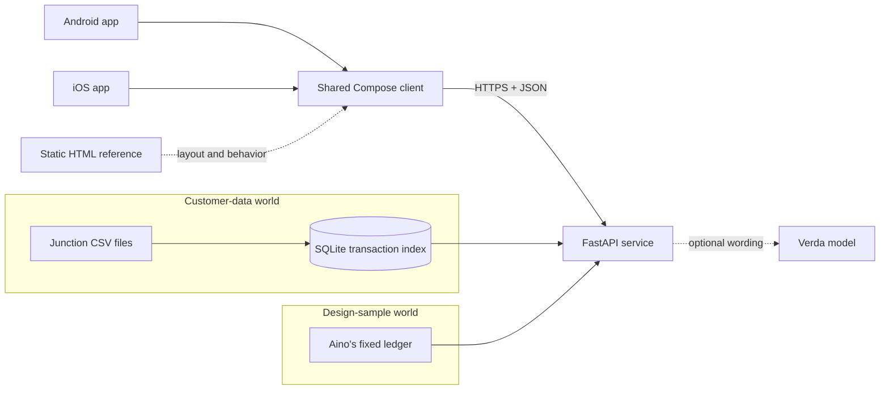

<h1 align="center"> SpendSight </h1> <br>
<p align="center">
  <a href="https://www.junctionconference.com/">
    
  </a>
</p>

<p align="center">
  Smart money coaching in your pocket. Built with Kotlin Multiplatform.
</p>

<!-- START doctoc generated TOC please keep comment here to allow auto update -->
<!-- DON'T EDIT THIS SECTION, INSTEAD RE-RUN doctoc TO UPDATE -->
## Table of Contents

- [Introduction](#introduction)
- [Features](#features)
- [At a glance](#at-a-glance)
- [Data boundaries](#data-boundaries)
- [Repository map](#repository-map)
- [Quick start](#quick-start)
- [Verification](#verification)
- [Core contributor rules](#core-contributor-rules)
- [Feedback](#feedback)
- [Acknowledgments](#acknowledgments)

<!-- END doctoc generated TOC please keep comment here to allow auto update -->

## Introduction

[](http://makeapullrequest.com)
[](LICENSE)
[](https://www.junctionconference.com/)

# SpendSight

SpendSight is a Junction 2026 mobile-banking prototype that turns transaction data into clear spending, saving, and financial-coach views. The product consists of a shared Kotlin Multiplatform app, a Python FastAPI service, and a static design reference.

**Available for both iOS and Android.** Built with Kotlin Multiplatform and Compose, SpendSight provides a unified, feature-rich banking experience across platforms.

> [!IMPORTANT]
> SpendSight contains two intentionally separate data worlds: a Junction customer dataset and Aino Korhonen's fixed design-sample ledger. Never combine their identities or figures.

## Features

A few of the things you can do with SpendSight:

* **Transaction Overview** — View your spending patterns and transaction history at a glance
* **Smart Categorization** — Automatic merchant-based spending classification with basket sorting
* **Financial Coach** — AI-powered assistant that answers money questions using your ledger data
* **Savings Tracker** — Monitor savings goals and safe-to-spend calculations
* **Budget Insights** — Charts and analytics for understanding your financial behavior
* **Promotions and Coupons** — Transparent Bonus earning and redemption display from S-group
* **Multi-platform** — Seamless experience on iOS and Android with shared business logic

<p align="center">
  
</p>

<p align="center">
  
</p>

## Tech Stack Icons

<p align="center">
  
  
  
  
  
  
</p>

<p align="center">
  
  
  
  
  
  
</p>

## At a glance

| Area | Technology | Responsibility |
| --- | --- | --- |
| Mobile | Kotlin Multiplatform, Compose Multiplatform, Ktor | Shared Android/iOS UI, state, navigation, localization, and API calls |
| Service | Python 3.11+, FastAPI, SQLite | API contracts, customer-data access, coach boundaries, and every financial calculation |
| Design | Static HTML and design notes | Visual and behavioral reference only; it is not the production client |
| Operations | Docker, Caddy, Terraform, GitHub Actions | Packaging, TLS, infrastructure, CI, and deployment |



The backend returns integer cents and display strings; the app presents them. Balances, Bonus, safe-to-spend, runway, and loan figures are never recomputed by the client.

## Data boundaries

| Data world | Source | Used for | Must not be presented as |
| --- | --- | --- | --- |
| Junction customers | Gitignored CSV files, indexed in `backend/.cache/junction.sqlite` | Customer Today, Spending, and Save views | Aino Korhonen's sample ledger |
| Design sample | `backend/app/ledger.py` | Sample tools, payments, charts, Bonus, purchase, watch, effort, and loan sketch | The selected Junction customer's activity |

Sample-backed screens carry a **Design sample** disclosure in the app. The sample's date and figures are fixed by the product design, not by the current date.

## Repository map

```text
SpendSight/
├── frontend/             Kotlin Multiplatform mobile client
│   ├── shared/           Shared Compose UI, store, API client, and DTOs
│   ├── androidApp/       Thin Android host
│   └── iosApp/           Thin iOS host
├── backend/              FastAPI service, ledgers, data access, and tests
├── design/my-money/      Static visual and behavior reference
├── infra/                Docker Compose, Caddy, deployment, and Terraform
├── BACKLOG.md            Product stories and exact oracle figures
└── AGENTS.md             Repository-wide contributor constraints
```

For implementation details, use the dedicated guides:

- [Frontend README](frontend/README.md) — app architecture, Android/iOS setup, API addressing, tests, and troubleshooting
- [Backend README](backend/README.md) — data setup, local HTTPS, routes, indexing, tests, and containers
- [Frontend behavior reference](frontend/APP.md) — exact screen-to-endpoint behavior
- [Backend API reference](backend/API.md) — route and runtime contract

## Quick start

### 1. Prerequisites

- Python 3.11 or newer
- [`uv`](https://docs.astral.sh/uv/) for Python dependencies
- JDK 17
- Android SDK 35 and an emulator or device
- macOS with Xcode for the iOS app
- The Junction CSV dataset at `Junction-2026-S-pankki/`, or `JUNCTION_DIR` pointing to it

The Junction dataset is intentionally excluded from Git. Backend tests use a small committed fixture automatically, but running the full service requires the real CSV files.

### 2. Start the backend

```bash
cd backend
uv sync --extra dev
mkdir -p .cache/certs
openssl req -x509 -newkey rsa:2048 -nodes \
  -keyout .cache/certs/localhost.key \
  -out .cache/certs/localhost.crt \
  -days 825 \
  -subj "/CN=localhost" \
  -addext "subjectAltName=DNS:localhost,IP:127.0.0.1"
uv run python -m app
```

The first start may take several minutes while the transaction CSV is indexed. In another terminal, verify it with:

```bash
curl -k https://127.0.0.1:8000/health
```

Interactive API docs are at [https://127.0.0.1:8000/docs](https://127.0.0.1:8000/docs). A browser warning is expected for the local self-signed certificate.

### 3. Run a mobile client

Android emulator:

```bash
cd frontend
./gradlew :androidApp:installDebug
adb shell am start -n fi.spendsight/fi.spendsight.MainActivity
```

iOS Simulator:

```bash
cd frontend/iosApp
unset OVERRIDE_KOTLIN_BUILD_IDE_SUPPORTED
xcodebuild \
  -project iosApp.xcodeproj \
  -scheme iosApp \
  -configuration Debug \
  -sdk iphonesimulator \
  -destination 'generic/platform=iOS Simulator' \
  -derivedDataPath build/DerivedData \
  build
```

The Android emulator reaches the host backend at `https://10.0.2.2:8000`; the iOS Simulator uses `https://127.0.0.1:8000`. See the [frontend guide](frontend/README.md#service-addresses) for deployed URLs and physical-device notes.

## Verification

Run the checks for the area you changed.

Backend (from the repository root):

```bash
cd backend
uv run ruff check .
uv run pytest
```

Frontend (from the repository root):

```bash
cd frontend
./gradlew :shared:allTests
./gradlew :androidApp:assembleDebug
```

For iOS-facing changes, also build the `iosApp` scheme in Xcode or with `xcodebuild`.

## Core contributor rules

- Keep shared screens in `frontend/shared/src/commonMain`; platform projects remain thin hosts.
- Keep APIs, persistence, data access, and financial math in Python under `backend/`.
- Represent money as integer `*_cents` fields and use the backend's euro formatting rules.
- Keep `frontend/shared/src/commonMain/kotlin/fi/spendsight/ApiDto.kt` aligned with backend response shapes.
- Use the `reads` paths returned by `GET /session`; do not construct customer routes from an assumed identity.
- Preserve explicit preview and confirmation boundaries. The coach cannot transfer money, open accounts, block cards, or approve loans.
- Treat `design/my-money/index.html`, `BACKLOG.md`, and `backend/tests/test_oracle.py` as the exact oracle for design-sample figures.
- Read the root and nearest nested `AGENTS.md` before making changes.

## Feedback

Feel free to send us feedback or [file an issue](https://github.com/minhson0506/SpendSight/issues/new). Feature requests are always welcome. If you wish to contribute, please take a quick look at the [AGENTS.md](./AGENTS.md) guidelines!

## Contributors

This project is brought to you by these awesome contributors:

- Son Dinh
- Giao Ngo
- Ngan Nguyen
- Hong Phan

## Acknowledgments

Thanks to the Junction 2026 organizers and all contributors who made SpendSight possible. This hackathon project showcases the power of Kotlin Multiplatform, FastAPI, and modern financial technology.
