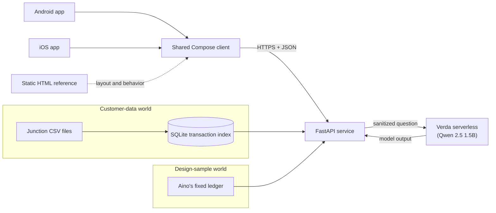

<h1 align="center"> SpendSight </h1> <br>
<p align="center">
  <a href="https://www.junctionconference.com/">
    
  </a>
</p>

<p align="center">
  Smart money coaching in your pocket. Built with Kotlin Multiplatform.
</p>

<!-- START doctoc generated TOC please keep comment here to allow auto update -->
<!-- DON'T EDIT THIS SECTION, INSTEAD RE-RUN doctoc TO UPDATE -->
## Table of Contents

- [Introduction](#introduction)
- [Features](#features)
- [At a glance](#at-a-glance)
- [Data boundaries](#data-boundaries)
- [Verda Compute Track](#verda-compute-track)
- [How we used the dataset](#how-we-used-the-dataset)
- [Repository map](#repository-map)
- [Quick start](#quick-start)
- [Verification](#verification)
- [Core contributor rules](#core-contributor-rules)
- [Feedback](#feedback)
- [Contributors](#contributors)

<!-- END doctoc generated TOC please keep comment here to allow auto update -->

## Introduction

[](http://makeapullrequest.com)
[](LICENSE)
[](https://www.junctionconference.com/)

# SpendSight

SpendSight is a Junction 2026 mobile-banking prototype that turns transaction data into clear spending, saving, and financial-coach views. The product consists of a shared Kotlin Multiplatform app, a Python FastAPI service, and a static design reference.

**Available for both iOS and Android.** Built with Kotlin Multiplatform and Compose, SpendSight provides a unified, feature-rich banking experience across platforms.

Experience our solution!
https://appetize.io/app/b_zyzwkf2r5ap7vvbeb3xwdjyija

## Features

A few of the things you can do with SpendSight:

* **Transaction Overview** — View your spending patterns and transaction history at a glance
* **Smart Categorization** — Automatic merchant-based spending classification with basket sorting
* **Financial Coach** — AI-powered assistant that answers money questions from your own transactions, in plain words, and declines investment, tax and legal advice
* **Savings Tracker** — Monitor savings goals and safe-to-spend calculations
* **Budget Insights** — Charts and analytics for understanding your financial behavior
* **Promotions and Coupons** — Transparent Bonus earning and redemption display from S-group
* **Multi-platform** — Seamless experience on iOS and Android with shared business logic

<p align="center">
  <a href="https://www.youtube.com/watch?v=kpBkAon_OHk&time_continue=8">
    
  </a>
</p>

**[Watch the SpendSight demo video on YouTube](https://www.youtube.com/watch?v=kpBkAon_OHk&time_continue=8)** — See the app in action with real customer data, coach interactions, and financial insights.

## Tech Stack Icons

<p align="center">
  
  
  
  
  
  
</p>

<p align="center">
  
  
  
  
  
  
</p>

## At a glance

| Area | Technology | Responsibility |
| --- | --- | --- |
| Mobile | Kotlin Multiplatform, Compose Multiplatform, Ktor | Shared Android/iOS UI, state, navigation, localization, and API calls |
| Service | Python 3.11+, FastAPI, SQLite | API contracts, customer-data access, coach boundaries, and every financial calculation |
| Design | Static HTML and design notes | Visual and behavioral reference only; it is not the production client |
| Operations | Docker, Caddy, Terraform, GitHub Actions | Packaging, TLS, infrastructure, CI, and deployment |



The backend returns integer cents and display strings; the app presents them. Balances, Bonus, safe-to-spend, runway, and loan figures are never recomputed by the client.

## Data boundaries

| Data world | Source | Used for | Must not be presented as |
| --- | --- | --- | --- |
| Junction customers | Gitignored CSV files, indexed in `backend/.cache/junction.sqlite` | Customer Today, Spending, and Save views, the coach, and the sample coupons | Aino Korhonen's sample ledger |
| Design sample | `backend/app/ledger.py` | Sample tools, payments, charts, Bonus, purchase, watch, effort, and loan sketch | The selected Junction customer's activity |

Sample-backed screens carry a **Design sample** disclosure in the app. The sample's date and figures are fixed by the product design, not by the current date.

## Verda Compute Track

SpendSight is our entry for the Junction 2026 **S-Pankki challenge**. The **Verda Compute Track** is the tech challenge we built it on: run an open-weight model for a banking coach on European infrastructure we control, instead of sending customer data to someone else's API.

### What runs on Verda

| Verda product | What we run on it | Why this one |
| --- | --- | --- |
| Inference / auto-scaling container (vLLM) | `Qwen/Qwen2.5-1.5B-Instruct` behind an OpenAI-compatible endpoint (`containers.verda.com`), called from `backend/app/verda.py` | A bank customer's transactions never go to a third-party AI API. The container scales with load and costs little when idle. |
| CPU instance (`CPU-TURIN.4V.16G`, Finland) | The FastAPI service, Caddy for TLS, and the SQLite transaction index, deployed with Docker Compose | The service needs RAM and a disk for the 3.6M-row index, not a GPU. A CPU instance is the cheapest fit. Terraform (`infra/terraform`) creates it, with an optional spot setting. |

Both sit in Verda's European data centers, so customer figures stay in the EU.

### How the judging criteria map

- **Ambition.** The coach reasons over a real customer's transaction history and answers in plain language, with cards for spending change, impulse spending, runway, subscriptions and invest-growth. A 1.5B open model served on managed compute makes that possible without a closed API. The service does the arithmetic and hands the model finished euro strings, so a small model is enough.
- **Fit.** The model goes on a serving product (an auto-scaling inference container) and the API goes on a CPU instance, rather than putting everything on one GPU box. We did not need GPU training, batch jobs or a cluster, so we did not use them.
- **Working prototype.** The whole stack runs: `infra/terraform` builds the VM, `infra/docker-compose.yml` runs the service, `infra/smoke.sh` checks it, and CI runs lint and tests. The [quick start](#quick-start) and [Verification](#verification) sections document the process. The coach needs `VERDA_API_KEY` and `VERDA_BASE_URL` (see [backend/README.md](backend/README.md)). Without them it returns 503 and the other screens still work.
- **Path to scale.**
  - **Model:** the inference container scales out on its own. Moving to a larger model, or a fine-tune on Verda GPU instances, is a `VERDA_MODEL` change.
  - **Service:** today it runs one worker, because Aino's sample ledger lives in memory. To scale, move that state out, run several workers behind Caddy or a load balancer, and replace the SQLite index with Postgres.
  - **Data:** the customer index is built once from CSVs. A real bank would feed the same views from its live transaction store.

## How we used the dataset

The S-Pankki challenge gave us the Junction 2026 dataset (`Junction-2026-S-pankki/`): 5,100 customers, 3.6 million transactions, and 200 mortgage applications with their event histories and final outcomes. This is how SpendSight uses it:

- **Transactions become the three customer screens.** The service indexes the transaction CSV once into SQLite. Today (safe to spend this week), Spending (where the money went, by category and basket), and Save (what a steady habit builds) are all computed in Python from one customer's rows. The app only shows the figures it is given.
- **The coach answers from the customer's own data.** A question about spending is sent to a small open model (Qwen 2.5 1.5B, served on Verda) together with that customer's figures as euro strings, so the model never does the arithmetic. Questions are normalised first, and the coach declines investment, tax and legal advice, questions about other people's money, and anything that would move money. Fixed cards (spending change, impulse, runway, subscriptions, invest-growth) sit under the prose answer.
- **Mortgage data stays context, not a verdict.** The customer summary shows whether a customer has a mortgage application and its recorded outcome. We never present that outcome as a prediction or promise for anyone. The file shows refusals most often came down to collateral, income, equity and existing debt, which is why the coach does not say yes or no to a loan.
- **Only the data we were given.** No figure is invented. Peer comparisons and education-asset context come from the dataset and public Statistics Finland tables. The Aino Korhonen design sample is kept apart so a real customer's figures are never mixed with it.
- **Privacy by design.** The service ignores any customer id in a request body, and questions are cleaned before they reach the model. The dataset stays out of Git; tests use a small committed fixture of three whole customers.

## Repository map

```text
SpendSight/
├── frontend/             Kotlin Multiplatform mobile client
│   ├── shared/           Shared Compose UI, store, API client, and DTOs
│   ├── androidApp/       Thin Android host
│   └── iosApp/           Thin iOS host
├── backend/              FastAPI service, ledgers, data access, and tests
├── design/my-money/      Static visual and behavior reference
├── infra/                Docker Compose, Caddy, deployment, and Terraform
├── BACKLOG.md            Product stories and exact oracle figures
└── AGENTS.md             Repository-wide contributor constraints
```

For implementation details, use the dedicated guides:

- [Frontend README](frontend/README.md) — app architecture, Android/iOS setup, API addressing, tests, and troubleshooting
- [Backend README](backend/README.md) — data setup, local HTTPS, routes, indexing, tests, and containers
- [Frontend behavior reference](frontend/APP.md) — exact screen-to-endpoint behavior
- [Backend API reference](backend/API.md) — route and runtime contract

## Quick start

### 1. Prerequisites

- Python 3.11 or newer
- [`uv`](https://docs.astral.sh/uv/) for Python dependencies
- JDK 17
- Android SDK 35 and an emulator or device
- macOS with Xcode for the iOS app
- The Junction CSV dataset at `Junction-2026-S-pankki/`, or `JUNCTION_DIR` pointing to it

The Junction dataset is intentionally excluded from Git. Backend tests use a small committed fixture automatically, but running the full service requires the real CSV files.

### 2. Start the backend

```bash
cd backend
uv sync --extra dev
mkdir -p .cache/certs
openssl req -x509 -newkey rsa:2048 -nodes \
  -keyout .cache/certs/localhost.key \
  -out .cache/certs/localhost.crt \
  -days 825 \
  -subj "/CN=localhost" \
  -addext "subjectAltName=DNS:localhost,IP:127.0.0.1"
uv run python -m app
```

The first start may take several minutes while the transaction CSV is indexed. In another terminal, verify it with:

```bash
curl -k https://127.0.0.1:8000/health
```

Interactive API docs are at [https://127.0.0.1:8000/docs](https://127.0.0.1:8000/docs). A browser warning is expected for the local self-signed certificate.

### 3. Run a mobile client

Android emulator:

```bash
cd frontend
./gradlew :androidApp:installDebug
adb shell am start -n fi.spendsight/fi.spendsight.MainActivity
```

iOS Simulator:

```bash
cd frontend/iosApp
unset OVERRIDE_KOTLIN_BUILD_IDE_SUPPORTED
xcodebuild \
  -project iosApp.xcodeproj \
  -scheme iosApp \
  -configuration Debug \
  -sdk iphonesimulator \
  -destination 'generic/platform=iOS Simulator' \
  -derivedDataPath build/DerivedData \
  build
```

The Android emulator reaches the host backend at `https://10.0.2.2:8000`; the iOS Simulator uses `https://127.0.0.1:8000`. See the [frontend guide](frontend/README.md#service-addresses) for deployed URLs and physical-device notes.

### 4. Install the Android APK

To try the app without building it, [download the APK](https://raw.githubusercontent.com/minhson0506/SpendSight/master/release/SpendSight_android.apk) and open it on an Android phone. It is a debug build, so Android may ask you to allow installs from this source. It calls the deployed service at `https://api.95-133-254-29.sslip.io`, so the phone needs an internet connection and no local backend.

To build the same APK yourself:

```bash
cd frontend
./gradlew :androidApp:assembleDebug -Pspendsight.apiUrl=https://api.95-133-254-29.sslip.io
# output: frontend/androidApp/build/outputs/apk/debug/androidApp-debug.apk
```

## Verification

Run the checks for the area you changed.

Backend (from the repository root):

```bash
cd backend
uv run ruff check .
uv run pytest
```

Frontend (from the repository root):

```bash
cd frontend
./gradlew :shared:allTests
./gradlew :androidApp:assembleDebug
```

For iOS-facing changes, also build the `iosApp` scheme in Xcode or with `xcodebuild`.

## Core contributor rules

- Keep shared screens in `frontend/shared/src/commonMain`; platform projects remain thin hosts.
- Keep APIs, persistence, data access, and financial math in Python under `backend/`.
- Represent money as integer `*_cents` fields and use the backend's euro formatting rules.
- Keep `frontend/shared/src/commonMain/kotlin/fi/spendsight/ApiDto.kt` aligned with backend response shapes.
- Use the `reads` paths returned by `GET /customers/{CUSTOMER_ID}`; do not construct customer routes from an assumed identity.
- Preserve explicit preview and confirmation boundaries. The coach cannot transfer money, open accounts, block cards, or approve loans.
- Treat `design/my-money/index.html`, `BACKLOG.md`, and `backend/tests/test_oracle.py` as the exact oracle for design-sample figures.
- Read the root and nearest nested `AGENTS.md` before making changes.

## Feedback

Feel free to send us feedback or [file an issue](https://github.com/minhson0506/SpendSight/issues/new). Feature requests are always welcome. If you wish to contribute, please take a quick look at the [AGENTS.md](./AGENTS.md) guidelines!

## Contributors

This project is brought to you by these awesome contributors:

- Son Dinh
- Giao Ngo
- Ngan Tran
- Hong Phan
