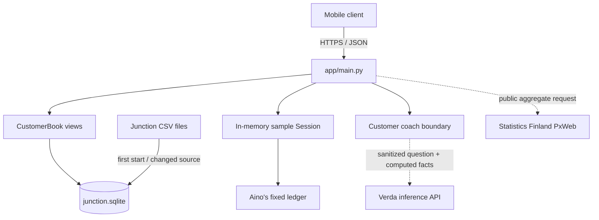
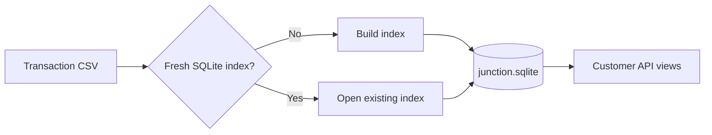
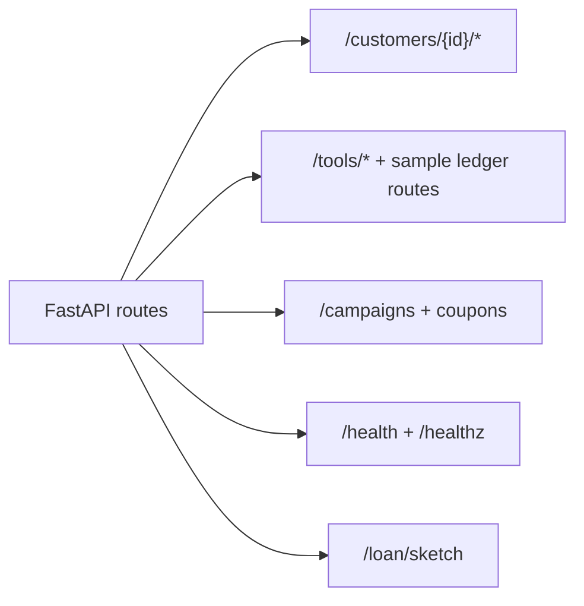

# SpendSight backend

The SpendSight backend is a Python 3.11+ FastAPI service. It owns the API contract, all financial calculations, Junction CSV access, the local SQLite transaction index, the fixed design-sample ledger, and coach safety boundaries.

For the complete route contract and example figures, also read [API.md](API.md). Once the service is running, FastAPI's interactive reference is at [https://127.0.0.1:8000/docs](https://127.0.0.1:8000/docs).

## Architecture



> [!IMPORTANT]
> The Junction customer dataset and Aino Korhonen's fixed design sample are unrelated. Aino's coach and tools never reinterpret Junction customer figures as hers, and customer screens must never display sample figures as customer data.

## Source layout

```text
backend/
├── app/
│   ├── main.py           FastAPI app and routes
│   ├── schemas.py        Request and response validation models
│   ├── junction_db.py    CSV loading and SQLite transaction index
│   ├── customer_data.py  Customer-level read models and calculations
│   ├── ledger.py         Fixed Aino design-sample ledger and math
│   ├── store.py          In-memory sample session, coach thread, and audit
│   ├── coach.py          Fixed sample-coach intent and safety rules
│   ├── verda.py          Customer-coach inference boundary and redaction
│   ├── statfi.py         Statistics Finland integration
│   ├── money.py          Integer-cent parsing and euro formatting
│   └── __main__.py       Local HTTPS Uvicorn entry point
├── tests/
│   ├── fixtures/junction/  Small committed Junction fixture
│   └── test_*.py           API, safety, data, and oracle tests
├── Dockerfile            Production API image
├── pyproject.toml         Python package, dependencies, pytest, and Ruff
├── uv.lock                Locked dependency graph
└── API.md                 Detailed API and runtime reference
```

## Quick start

### 1. Install dependencies

From `backend/`:

```bash
uv sync --extra dev
```

### 2. Set up local HTTPS

Create a self-signed certificate (one time only):

```bash
mkdir -p .cache/certs
openssl req -x509 -newkey rsa:2048 -nodes \
  -keyout .cache/certs/localhost.key \
  -out .cache/certs/localhost.crt \
  -days 825 \
  -subj "/CN=localhost" \
  -addext "subjectAltName=DNS:localhost,IP:127.0.0.1"
```

### 3. Start the service

```bash
uv run python -m app
```

Verify it's running:

```bash
curl -k https://127.0.0.1:8000/health
```

Interactive API docs: [https://127.0.0.1:8000/docs](https://127.0.0.1:8000/docs)

**Note:** First start may take several minutes while Junction transaction CSVs are indexed into SQLite.

## Requirements

- Python 3.11 or newer; the container uses Python 3.12
- [`uv`](https://docs.astral.sh/uv/) for dependency and environment management
- OpenSSL for the local development certificate
- The four Junction CSV files for a full local service run

Install all locked runtime and development dependencies from `backend/`:

```bash
uv sync --extra dev
```

## Data setup

By default, the service looks for this gitignored directory beside `backend/`:

```text
Junction-2026-S-pankki/
├── tx_customers_junction.csv
├── tx_junction_transactions.csv
├── mtg_tx_customer_link_and_final_mtg_infio.csv
└── mtg_negotiation_history.csv
```

Override the location when necessary:

```bash
export JUNCTION_DIR=/absolute/path/to/Junction-2026-S-pankki
```

The large transaction file is converted to `backend/.cache/junction.sqlite`. On later starts, the service reuses that index when it is newer than the CSV. Set `SPENDSIGHT_CACHE_DIR` to store the index elsewhere.



The first full-data start can take several minutes. A Git LFS pointer is not valid input; download the real CSV content.

Tests do not require the private dataset. They point `JUNCTION_DIR` to `tests/fixtures/junction` and build an index in a temporary directory automatically.

## Local HTTPS setup

Create a development certificate once from `backend/`:

```bash
mkdir -p .cache/certs
openssl req -x509 -newkey rsa:2048 -nodes \
  -keyout .cache/certs/localhost.key \
  -out .cache/certs/localhost.crt \
  -days 825 \
  -subj "/CN=localhost" \
  -addext "subjectAltName=DNS:localhost,IP:127.0.0.1"
```

Both files are ignored by Git. The mobile clients only extend trust to a local development certificate identifying `localhost` or `127.0.0.1`.

## Run locally

```bash
uv run python -m app
```

This starts Uvicorn at `https://127.0.0.1:8000` with one in-memory sample session. Verify readiness from another terminal:

```bash
curl -k https://127.0.0.1:8000/health
curl -k https://127.0.0.1:8000/healthz
```

| URL | Purpose |
| --- | --- |
| `/health` | Basic service and loaded-dataset summary |
| `/healthz` | Container-oriented readiness; returns 503 until the index is ready |
| `/docs` | Swagger UI generated from the FastAPI contract |
| `/openapi.json` | Machine-readable OpenAPI schema |

The local entry point binds loopback only. An Android emulator reaches it through `https://10.0.2.2:8000`; a physical device requires a deliberately configured reachable interface and URL.

## Configuration

| Name | Required | Purpose |
| --- | --- | --- |
| `JUNCTION_DIR` | No | Overrides the default Junction CSV directory |
| `SPENDSIGHT_CACHE_DIR` | No | Overrides the default `.cache` directory for `junction.sqlite` |
| `VERDA_API_KEY` | For customer coach inference | Bearer credential for the Verda inference endpoint |
| `VERDA_BASE_URL` | For customer coach inference | Deployment base URL; `/v1/chat/completions` is appended when needed |
| `VERDA_MODEL` | No | Model id; defaults to the value in `app/verda.py` |
| `SPENDSIGHT_TEST_FULL_DATA` | Tests only | Set to `1` to enable full-dataset tests |

Verda settings can be environment variables or entries in the gitignored `backend/.env` file:

```dotenv
VERDA_API_KEY=replace-with-a-secret
VERDA_BASE_URL=https://containers.verda.com/replace-with-deployment
VERDA_MODEL=replace-with-model-id
```

Never commit `.env`, certificates, CSV data, or the SQLite cache.

## API map



| Group | Representative routes | Data source |
| --- | --- | --- |
| Customer views | `/customers/{id}`, `/customers/{id}/today`, `/customers/{id}/spending`, `/customers/{id}/save` | Junction customer transactions |
| Customer coach | `/customers/{id}/coach/ask` | Backend-computed customer facts with the Verda safety boundary |
| Offers | `/campaigns`, `/customers/{id}/coupons`, `/customers/{id}/coupons/{coupon_id}/activate` | S-Pankki sample offers and qualifications |
| Design-sample ledger | `/ledger/summary`, `/payments`, `/settings/effort` | Aino's fixed ledger and in-memory session |
| Design-sample tools | `/tools/week`, `/tools/spender`, `/tools/dining`, `/tools/impulse`, `/tools/runway`, `/tools/subscriptions`, `/charts`, `/bonus`, `/purchase`, `/watch` | Aino's fixed ledger |
| Loan calculator | `/loan/sketch?price_eur=...&rate_percent=...&years=...&down_percent=...` | Parameter-only arithmetic |

See [API.md](API.md) for route parameters, validation rules, response semantics, and reference customer figures.

### Customer entry point

`GET /customers/{customer_id}` is the client entry point. It returns the customer's summary, account balance, transaction count, and a `reads` object containing the exact Today, Spending, and Save paths. The client follows those paths. A customer id supplied in a request body does not choose the signed-in identity.

### Money contract

- Money is represented as integer cents in fields ending with `*_cents`.
- `app/money.py` is the formatting authority.
- Negative display values use the Unicode minus sign (`−`), not an ASCII hyphen.
- The mobile app renders returned figures and must not independently recompute financial results.

### Coach and action boundaries

- Refused sample-coach answers do not read or expose ledger amounts.
- An allowed sample-coach answer executes exactly one named tool; generated wording cannot change its figure.
- Customer questions are sanitized before inference. Sensitive identifiers and control characters are replaced or removed.
- The model may phrase an answer, but Python chooses and computes the facts.
- The coach cannot move money, open accounts, block cards, cancel subscriptions, approve loans, or call transfer paths.
- Preview and confirmation are separate product steps.
- Question text is not stored in the sample audit log.

## Tests and lint

The default suite uses committed fixture data:

```bash
uv run ruff check .
uv run pytest
```

Run only the financial oracle checks:

```bash
uv run pytest tests/test_oracle.py
```

Run against the full gitignored dataset, including tests marked `full_data`:

```bash
SPENDSIGHT_TEST_FULL_DATA=1 uv run pytest
```

The fixture retains complete transaction histories for its included customers, so customer-level expected figures remain meaningful without the multi-million-row source file.

## Container

The production image runs plain HTTP on port 8000 because Caddy terminates TLS in front of it.

From the repository root:

```bash
docker build -t spendsight-api backend
docker run --rm -p 8000:8000 \
  -v "$PWD/Junction-2026-S-pankki:/data/junction:ro" \
  -v "$PWD/backend/.cache:/data/cache" \
  spendsight-api
```

The image:

- uses Python 3.12 and the locked `uv` environment;
- runs as non-root UID 1000;
- expects read-only CSV data at `/data/junction`;
- requires a writable cache at `/data/cache`;
- uses one worker because the design-sample session is in memory;
- exposes `/healthz` for readiness.

The container serves `http://127.0.0.1:8000` on the mapped local port. The deployment configuration under `../infra/` adds Caddy and public HTTPS.

## Common changes

### Add or change a response field

1. Update the backend implementation and, when applicable, `schemas.py`.
2. Add focused route or serialization tests.
3. Update `../frontend/shared/src/commonMain/kotlin/fi/spendsight/ApiDto.kt` and its use sites.
4. Update [API.md](API.md) and [frontend/APP.md](../frontend/APP.md).

### Change financial behavior

1. Identify whether the value belongs to the Junction customer world or the fixed design sample.
2. Keep the calculation in the backend.
3. Preserve exact oracle figures unless the product oracle changes deliberately.
4. Add a focused test, including `test_oracle.py` when a sample figure is involved.

### Refile a sample payment

Refiling may change category and basket calculations, but it must not change whether the merchant earns Bonus.

## Troubleshooting

| Symptom | Likely cause | Fix |
| --- | --- | --- |
| `Missing TLS certificate` | Local certificate files do not exist | Follow [Local HTTPS setup](#local-https-setup) |
| `Missing ...csv` | The Junction dataset path is wrong or incomplete | Populate the default directory or set `JUNCTION_DIR` |
| CSV rejected as a Git LFS pointer | The large file was not downloaded | Fetch the real CSV content, not the pointer file |
| First start appears idle | The transaction index is building | Wait and monitor process output; cold indexing can take minutes |
| `/healthz` returns 503 | The index is not ready or data failed to load | Inspect the response's `index` field and server logs |
| Customer coach returns 503 | Verda credentials or base URL are missing | Configure `VERDA_API_KEY` and `VERDA_BASE_URL` |
| Customer coach returns 502 | Upstream inference failed | Check the deployment URL, model id, and Verda availability |
| Full-data test is skipped | Default tests use fixture mode | Run with `SPENDSIGHT_TEST_FULL_DATA=1` |

## Contribution guardrails

- Keep the service and all ledger math in Python; do not add a Java or Kotlin API service.
- Do not mix Junction customer figures with Aino's design-sample figures.
- Do not invent missing benchmarks, time series, lending decisions, or customer data.
- Preserve server-selected identity and the `reads` paths returned by `/session`.
- Keep local data, secrets, caches, environments, and generated artifacts out of version control.
- Read [AGENTS.md](AGENTS.md) and the [root contributor guide](../AGENTS.md) before editing.
