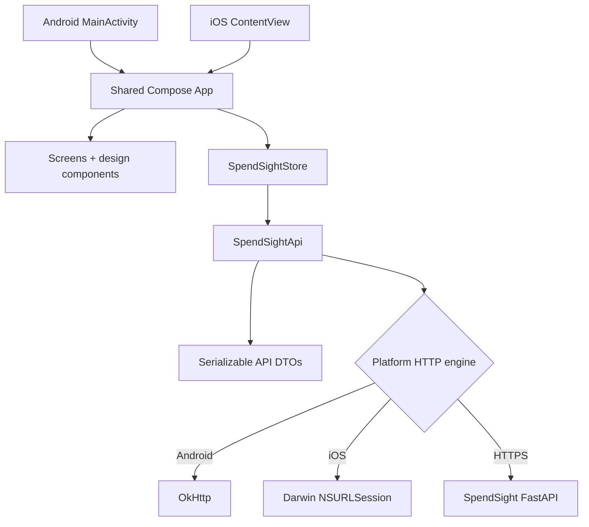
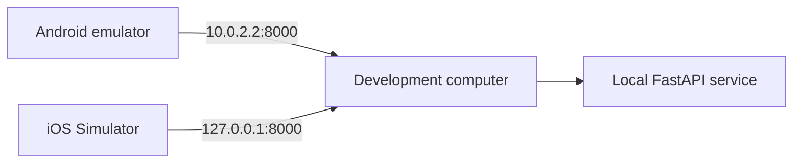
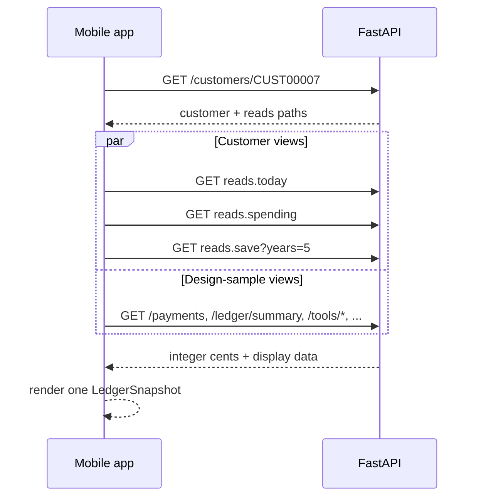

# SpendSight mobile client

The SpendSight client is a Kotlin Multiplatform app with one shared Compose UI for Android and iOS. Android and iOS provide only the platform host and HTTP engine; screens, navigation, state, localization, DTOs, and API orchestration live in `shared/src/commonMain`.

For the exact screen-to-endpoint behavior, also read [APP.md](APP.md).

## Architecture



| Layer | Main files | Responsibility |
| --- | --- | --- |
| App shell | `App.kt`, `Model.kt` | App lifecycle, tabs, stack navigation, sheets, dialogs |
| Screens | `Screens.kt`, `Theme.kt`, `UiCopy.kt` | Shared Compose UI, reusable visual tokens, fixed product copy |
| State | `Store.kt` | Loading, interaction state, asynchronous calls, stale-response protection |
| Networking | `ApiClient.kt`, platform `Http.kt` files | Ktor calls, timeouts, JSON, service address, local certificate handling |
| Contract | `ApiDto.kt` | Kotlin serialization shapes matching backend responses |
| Localization | `L10n.kt`, `translations/` | English, Finnish, and Swedish UI strings and amount presentation |
| Hosts | `androidApp/`, `iosApp/` | Platform entry points and packaging only |

## Source layout

```text
frontend/
├── shared/
│   └── src/
│       ├── commonMain/
│       │   ├── kotlin/fi/spendsight/   Shared app, UI, store, API, and DTOs
│       │   └── translations/           EN, FI, and SV string resources
│       ├── commonTest/                  Shared tests
│       ├── androidMain/                 Android Ktor/OkHttp implementation
│       └── iosMain/                     iOS Ktor/Darwin implementation
├── androidApp/                          Android application host
├── iosApp/                              Xcode project and iOS host
├── gradle/libs.versions.toml            Dependency and plugin versions
└── APP.md                               Detailed runtime behavior
```

## Requirements

| Requirement | Version or note |
| --- | --- |
| JDK | 17 |
| Android compile/target SDK | 35 |
| Android minimum SDK | 26 |
| Kotlin | 2.0.10 |
| Compose Multiplatform | 1.6.11 |
| iOS deployment target | 15.0 |
| Backend | Running before the opening app load |

Use the checked-in Gradle wrapper (`./gradlew`); a global Gradle installation is not needed.

## Start the backend first

The app's opening load needs the FastAPI service. From the repository root:

```bash
cd backend
uv sync --extra dev
uv run python -m app
```

Local HTTPS also requires the certificate pair described in the [backend README](../backend/README.md#local-https-setup). Wait until this succeeds before launching the app:

```bash
curl -k https://127.0.0.1:8000/health
```

## Run on Android

Start an emulator or connect and authorize a device, then run from `frontend/`:

```bash
./gradlew :androidApp:installDebug
adb shell am force-stop fi.spendsight
adb shell am start -n fi.spendsight/fi.spendsight.MainActivity
```

If more than one Android target is connected, add `-s <serial>` to each `adb` command and set Gradle's `ANDROID_SERIAL` for the install.

Build without installing:

```bash
./gradlew :androidApp:assembleDebug
```

## Run on iOS

Open `frontend/iosApp/iosApp.xcodeproj`, select the `iosApp` scheme and an iOS Simulator, and run it. The Xcode build phase invokes Gradle to embed the shared framework.

The equivalent command-line build is:

```bash
cd iosApp
unset OVERRIDE_KOTLIN_BUILD_IDE_SUPPORTED
xcodebuild \
  -project iosApp.xcodeproj \
  -scheme iosApp \
  -configuration Debug \
  -sdk iphonesimulator \
  -destination 'generic/platform=iOS Simulator' \
  -derivedDataPath build/DerivedData \
  build
```

The built app is at `iosApp/build/DerivedData/Build/Products/Debug-iphonesimulator/SpendSight.app`. Building and launching on iOS requires macOS, Xcode, and an installed Simulator runtime.

## Service addresses



| App target | Default base URL | Why |
| --- | --- | --- |
| Android emulator | `https://10.0.2.2:8000` | `10.0.2.2` is the emulator's alias for the host computer |
| iOS Simulator | `https://127.0.0.1:8000` | The simulator can reach the Mac's loopback service |
| Deployed build | `https://host` | Supplied at build time; no path or trailing slash |

`127.0.0.1` inside the Android emulator refers to the emulator itself, not the development computer.

Set a deployed service URL with one of the following. The first available value wins:

1. Gradle property: `-Pspendsight.apiUrl=https://api.example.com`
2. Environment variable: `SPENDSIGHT_API_URL=https://api.example.com`
3. `frontend/local.properties`: `spendsight.apiUrl=https://api.example.com`

Examples:

```bash
./gradlew :androidApp:installDebug \
  -Pspendsight.apiUrl=https://api.example.com
```

```properties
# frontend/local.properties (gitignored; convenient for Xcode builds)
spendsight.apiUrl=https://api.example.com
```

Change the setting and rebuild; the store reads the generated address when it is created. The URL validator accepts HTTPS hosts with an optional port, but no path.

A physical phone cannot use the emulator defaults. It needs a reachable HTTPS host or the development computer's LAN address, and the backend must listen on that interface. The standard local backend binds only to `127.0.0.1`.

### Local certificate behavior

Android and iOS accept the SpendSight self-signed development certificate only for local addresses: loopback, the Android host alias, and private LAN ranges. Public hosts use the normal platform trust store. The certificate must identify `localhost` or `127.0.0.1`; do not weaken this boundary to accept arbitrary certificates.

## Startup data flow

The first request is `GET /customers/CUST00007` (`CUSTOMER_ID` in `ApiClient.kt`). Its `reads` object names the selected customer's Today, Spending, and Save paths. The client preserves those server-provided paths instead of constructing endpoints from a customer id.



After that, the remaining opening calls run in parallel. One failure fails the whole opening load and shows the service error plus the build's base URL. “Try again” repeats the load.

## Screens and data ownership

| Area | Data source | Notes |
| --- | --- | --- |
| Today | `reads.today` | Selected Junction customer's latest balance and activity |
| Spending | `reads.spending` | Selected customer's month and transaction categories |
| Save | `reads.save` | Recorded customer deposits; it does not move money |
| SpendSight chat | Customer-scoped coach endpoint | Sends at most 280 characters; the backend owns facts and safety boundaries |
| Sample tools and planning screens | `/tools/*`, payments, charts, Bonus, purchase, watch, effort, loan sketch | Must retain the visible **Design sample** disclosure |

The app may format backend cents for the selected language, but it must not independently derive balances, safe-to-spend, Bonus, runway, loan payments, or other financial results. The backend response remains the authority even when rows are grouped for presentation.

## Localization

The top bar switches between Finnish (`FI`), English (`EN`), and Swedish (`SW`). The choice is device-local.

String sources are under:

```text
shared/src/commonMain/translations/
├── values/             English
├── values-fi-rFI/      Finnish
└── values-sv-rFI/      Swedish
```

The Gradle build generates `StringTable.kt` and fails if the three languages have different keys. Add the same key to every locale. Known category and transaction-type names are localized for display; API filing requests continue to send their stable English names.

## Changing the API contract

When a backend response changes:

1. Change the backend schema and implementation.
2. Update `shared/src/commonMain/kotlin/fi/spendsight/ApiDto.kt`.
3. Update `ApiClient.kt`, `Store.kt`, and affected screens.
4. Add or update focused backend and shared-client tests.
5. Update [APP.md](APP.md) and [backend/API.md](../backend/API.md).

Keep money fields as integer `*_cents` values. Preserve the `reads` paths returned by `/customers/{CUSTOMER_ID}`.

## Tests and verification

From `frontend/` with JDK 17:

```bash
./gradlew :shared:allTests
./gradlew :androidApp:assembleDebug
```

For iOS-facing changes, also build the `iosApp` scheme. A successful build does not count as runtime UI verification; launch the relevant app before claiming that the UI was verified.

## Troubleshooting

| Symptom | Likely cause | Fix |
| --- | --- | --- |
| “Failed to connect to /127.0.0.1:8000” on Android | The emulator is calling itself | Use the default `https://10.0.2.2:8000` and rebuild |
| “The service did not answer” | One opening request failed | Confirm `/health`, inspect the displayed base URL, then check backend logs |
| TLS or hostname error locally | Missing or incorrect dev certificate | Regenerate the localhost certificate using the backend guide |
| Xcode builds with an old URL | `local.properties` is still set | Change or remove `spendsight.apiUrl`, then rebuild |
| Gradle uses the wrong Java | JDK 17 is not active | Set `JAVA_HOME` to a JDK 17 installation |
| iOS shared framework is missing | Xcode skipped the Gradle build phase | Unset `OVERRIDE_KOTLIN_BUILD_IDE_SUPPORTED` and rebuild |

## Design and contribution guardrails

- Implement all product screens in shared Compose code; do not add React, a web view, a separate SwiftUI screen set, or Android-only Java UI.
- Reuse `Theme.kt` and `UiCopy.kt` instead of creating near-duplicate colors or fixed copy.
- Match `../design/my-money/index.html` and `../design/my-money/NOTES.md` while respecting the repository architecture.
- Preserve unrelated changes and generated-file boundaries.
- Read [AGENTS.md](AGENTS.md) and the [root contributor guide](../AGENTS.md) before editing.
